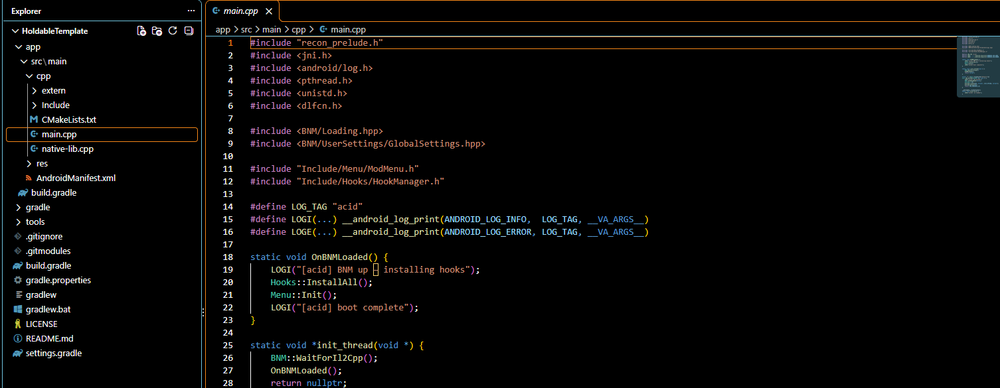

# Ac1d Source Leak

## This is .gg/ac1d menu's source code! Have fun, fuckers! You can access a prebuilt lib in Releases of this repo. Why'd i do this? Fully vibecoded! Yeah, i mean fully. If you want more leaks, go to discord.gg/vrmodding

## This **WONT** be taken down, Dex can have a cry or a bitch about it, or both. Either way, too bad.

## How was this RE'd? Ghidra, CPPSpy, Claude (3 Max agents) And took about 43 minutes, 38 minutes of that was ghidra analyzing.

Who made this? Thingyyy - Owner @ .gg/vrmodding If you disagree with this leak, piss yourself!
